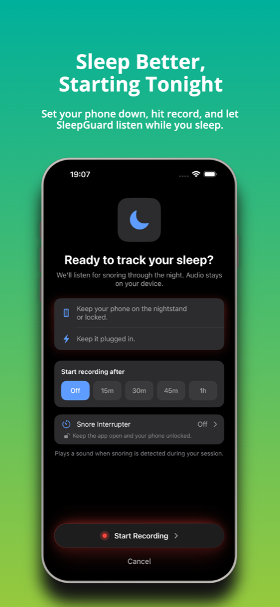
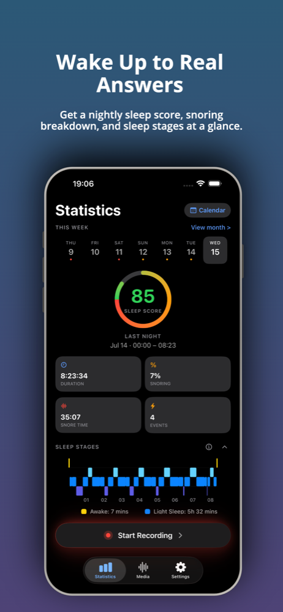
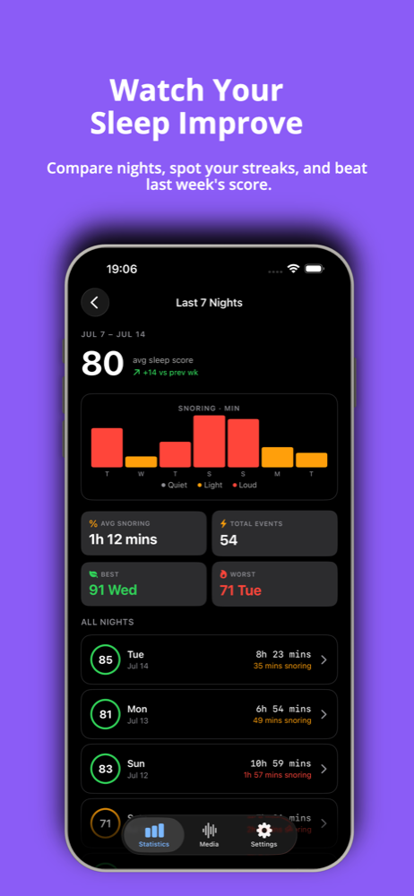
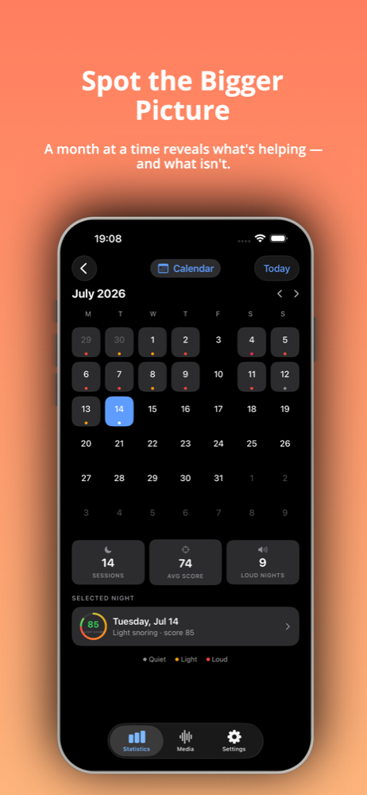
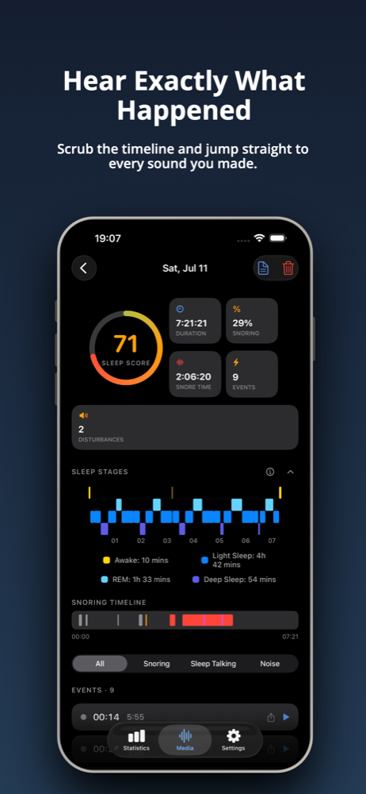
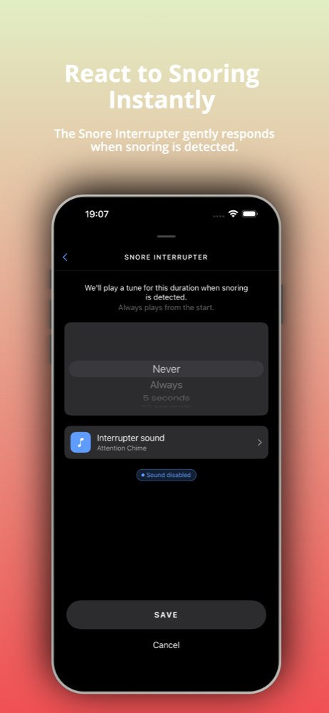

# SleepGuardUIKitWay

> A bedside sleep and snoring tracker for iOS. It listens while you sleep, detects snoring and sleep talking on the device, scores your night, and shows how your sleep trends over time.

Under the hood it's built the way a large UIKit team would build it: **UIKit screens and coordinators**, with the shared **SwiftUI** views as their cells and pages, on a **hexagonal core**, and **four white-label apps** ship from one codebase.

**One product, two architectures.** This is the UIKit-first sibling of [SleepGuard](https://github.com/dardan0x/SleepGuard), the same app built in pure SwiftUI. Both build against [SleepGuardShared](https://github.com/dardan0x/SleepGuardShared), which holds the domain rules, strings, design system and screen layouts, and also the code behind this app's adapters: the audio engine, the nights' SwiftData schema, the files and their layout, settings, HealthKit mapping and logging. Detection runs on the same 20 Hz samples in both apps, and a call is left out of the score in both, so the same sound yields the same events, score and screens as in SleepGuard. Navigation, dependency injection, persistence boundaries, project generation and white-labelling are built differently, on purpose.


Further reading: [Architecture](docs/ARCHITECTURE.md) (the full reference, checked against the code) · [Comparison with SleepGuard](docs/COMPARISON.md) (one feature in both shapes, with costs) · [Adding a brand](docs/ADDING_A_BRAND.md) (the real diff) · [ADRs](docs/adr/)

<p align="center">
  
  
  
  
  
  
</p>

---

## What it does

| Capability | Notes |
|---|---|
| **Overnight recording** | Bedside clock with live level, delayed start, background recording, recovery of a night killed by the system |
| **Snore and sleep-talk detection** | SoundAnalysis confidence and sound level, classified per sample, turned into events by the shared detection state machine on its own actor |
| **Sleep score** | 0–100 from snoring time, episodes per hour, intensity, sleep talking, duration and, with Apple Health, sleep stages |
| **Playback** | Per-event clips, events in sequence, enhanced audio |
| **Statistics** | Dashboard, trends, calendar, Last 7 Nights |
| **Apple Health** | Writes nights, reads Watch sleep stages (brands with HealthKit only) |
| **Snore Interrupter** | A built-in or recorded melody when snoring starts; capture pauses while it plays |
| **Morning briefing, report, sharing** | Recap against your recent average with a lifestyle survey; a paged PDF report; clip sharing |

### Brands

| Brand | Theme | Capabilities |
|---|---|---|
| **SleepGuard** | SleepGuard's dark blue | Apple Health, Snore Interrupter, Learn |
| **Nocturne** | Violet, rounded type, Sessions tab first | Apple Health, Snore Interrupter, Learn |
| **SleepGuard Lite** | Teal | No HealthKit linked, no Interrupter, no Learn |
| **Dawn** | Warm sunrise | Apple Health; no Interrupter, no Learn |

A brand is a `BrandConfiguration` value, an asset catalog and an entry in the Tuist brand list. Adding Dawn changed 8 files (+117 lines) and no feature or domain code.

---

## Architecture: a hexagonal core inside a UIKit shell

### Why hexagonal

A sleep tracker's important logic sits next to the hardware and the system. One night touches the microphone, a classifier, the file system, SwiftData, HealthKit and an audio player. Three requirements made ports and adapters the right fit here:

- **The riskiest code must be testable without a device.** Recording a night, recovering it after a crash, committing it and scoring it are the behaviours users notice when they break. As use cases and an actor over ports, they run on macOS with `swift test` in seconds, against fakes.
- **Brands differ in infrastructure, not in behaviour.** SleepGuard Lite links no HealthKit. With a `SleepStageSource`, that's a composition decision (pass `nil`) rather than `#if` or brand checks across the codebase.
- **Frameworks are details with a shelf life.** SwiftData, AVFoundation and HealthKit each sit behind one adapter. Replacing one (a different store, a different capture pipeline) changes one module and its tests.

It also reflects how large iOS codebases tend to be organised: a UI layer that changes often, over a domain that shouldn't.

### How it works here

```
        driving side                                    core                                       driven side
┌──────────────────────────┐            ┌──────────────────────────────────┐            ┌────────────────────────────────┐
│ AppShell                 │            │ SleepDomain (application layer)  │            │ SleepPersistence               │
│   coordinators, flows,   │  calls     │   use cases: LoadSessionDetail,  │  ports     │   @ModelActor over SleepStore, │
│   factories              │ ─────────► │   CommitSession, DeleteSession,  │ ─────────► │   SleepFiles stores            │
│ Features                 │            │   LoadMorningBriefing, …         │            │ SleepAudio                     │
│   UIKit screens via      │            │   RecordingSession (actor)       │            │   SleepAudioKit (AVFoundation) │
│   Dependencies closures  │            │ ──────────────────────────────── │            │ SleepHealth                    │
└──────────────────────────┘            │ SleepCore (shared; domain model) │            │   SleepHealthKit (HealthKit)   │
                                        │   Night, rules, DetectionEngine  │            └────────────────────────────────┘
                                        └──────────────────────────────────┘
```

- **The core has two rings.** `SleepCore` (from SleepGuardShared) is the domain model: entities and pure rules, shared with SleepGuard. `SleepDomain` is this app's application layer: it orchestrates those rules over ports. Neither imports an Apple framework beyond Foundation.
- **Ports are owned by the core and named for its needs**: `SessionRepository`, `SessionFileStore`, `AudioCapture`, `SleepStageSource`, `RecordingCheckpointStore`, `ClipPlayer`, `MelodyPlayer`, `ProfileStore`, `LifestyleLogStore`, and others (12 in all). Each has a fake in `SleepDomainTestSupport`.
- **Use cases are small values** composed from ports, invoked with `callAsFunction`:

```swift
/// Opens a night for the detail screen. A query: it never writes.
public struct LoadSessionDetail: Sendable {
  public init(sessions: any SessionRepository, scoreConfig: SleepScoreConfig = .default)

  public func callAsFunction(_ id: Night.ID) async throws -> SessionDetail {
    try await SessionDetail(sessions.session(id: id), scoreConfig: scoreConfig)
  }
}

/// Adds sleep stages to a night that has none, and stores them with the new
/// score. A separate command, so opening a night never depends on a write.
public struct EnrichNightWithStages: Sendable {
  public func callAsFunction(_ night: Night) async -> SessionDetail? {
    guard night.sleepStages.isEmpty,
          let stages = try? await sleepStages.stages(from: night.start, to: night.end), !stages.isEmpty else { return nil }
    var night = night
    night.sleepStages = stages
    let detail = SessionDetail(night, scoreConfig: scoreConfig)
    try? await sessions.updateStages(
      of: night.id, stages: stages, summary: detail.summary, scoreVersion: SleepScore.cacheVersion(for: scoreConfig))
    return detail
  }
}
```

- **Adapters map at the boundary.** `SleepPersistence` keeps the shared `SleepStore` records inside its actor and returns `Night` values; no `@Model` crosses a port. `SleepAudio` conforms the shared `SleepAudioKit` types to the audio ports (`CaptureEngine` yields `CaptureSample`s); `SleepHealth` maps HealthKit samples through the shared `HealthKitSleep`. The implementations are shared with SleepGuard ([ADR 0013](docs/adr/0013-uniform-apps.md)); the ports are this app's.
- **The shell is the only place that knows both sides.** `AppShell` registers adapters against ports in the Factory container and hands use cases to screens as closures.

**Costs, stated plainly:** more files per feature, an explicit mapping in each adapter, and a composition root to maintain. For a single-brand app with a small team, SleepGuard's service-based shape is cheaper (see the comparison below).

---

## Modules

```
Apps/<Brand>             Brand.swift: BrandConfiguration (theme, tabs, Health port, capabilities)
└─► AppShell             composition root: coordinators, flows, factories, Factory container
    ├─► Features         8 modules of UIKit screens hosting the shared content: Dependencies in, Routes out
    ├─► ScreenKit        ScreenController, ContentListController, ScreenChrome, Navigator
    ├─► Adapters         SleepPersistence · SleepAudio · SleepHealth (over the shared store, audio kit, files)
    └─► SleepDomain      ports, use cases, RecordingSession actor
            └─► SleepCore and the kits (SleepGuardShared, pinned release)
```

| Layer | Module | Size | Responsibility | Must not |
|---|---|---|---|---|
| Domain | `SleepDomain` | 1.3k lines | 12 ports, the use cases, the `RecordingSession` actor, preferences. Written in `SleepCore` types | Import any Apple framework beyond Foundation |
| Adapters | `SleepPersistence` | 0.4k | The shared `SleepStore` records behind `SessionRepository` (`@ModelActor`); the shared files for clips, checkpoint, profile, survey, raw log; preferences | Expose a `@Model` beyond its port |
| | `SleepAudio` | 78 | Factories and conformances: the shared `SleepAudioKit` (capture, compression, playback, waveforms, melodies) behind the audio ports | |
| | `SleepHealth` | 44 | HealthKit read and write over the shared `HealthKitSleep` | Be linked by Lite |
| Presentation | `ScreenKit` | 0.6k | `ScreenController`, every screen's base (theme, chrome, one state child, hosting the shared views); a self-sizing UIKit list; the `Navigator` abstraction | |
| Features | 8 modules | 3.7k | 22 UIKit screens (collection views, a page view controller, alerts) around the shared SwiftUI content; each with a view model (ADR 0008): History, SessionDetail, Statistics, Recording, Settings, Onboarding, Briefing, Learn | Navigate, present anything but an alert, persist, resolve dependencies, use `UIApplication`; a view model imports no UI |
| Shell | `AppShell` | 2.1k | `AppComposition` (the composition root), `AppCoordinator` (launch, links), `MainTabCoordinator`, 6 flows and their navigation helpers, factories, 33 container registrations | Be imported by anything but the brand targets |

Dependencies point inwards. The domain knows no framework; adapters implement its ports; features know the domain's types and the shared content but not how they are presented; only `AppShell` knows everything.

---

## How the modules interact

A feature never calls another feature, the shell, or an adapter. Every interaction goes through one of four contracts:

| Contract | Direction | Defined in | Implemented by |
|---|---|---|---|
| **Port** | domain → infrastructure | `SleepDomain` (`SessionRepository`, `AudioCapture`, `SleepStageSource`, …) | Adapters |
| **Use case** | screen → domain | `SleepDomain` (`LoadSessionDetail`, `CommitSession`, `LoadMorningBriefing`, …) | Itself; composed from ports |
| **`Dependencies`** | shell → screen (data in) | Each feature | `AppShell` factories |
| **`Routes`** | screen → shell (intent out) | Each feature | `AppShell` flows |

Opening a night from History exercises all four:

```
HistoryViewController ── viewModel.open(summary) ── routes.openNight(summary) ──► HistoryFlow
                                                  │
                                                  ▼
                                      NightDetailNavigation.show(summary)
                                                  │  SessionDetailFactory resolves LoadSessionDetail,
                                                  │  builds SessionDetailViewModel(dependencies:routes:), then
                                                  │  SessionDetailViewController(viewModel:theme:chrome:)
                                                  ▼
                                      navigator.push(controller)
                                                  │
SessionDetailViewModel ── await loadDetail(id) ──► LoadSessionDetail ──► SessionRepository ──► SleepPersistence
                       └─ then enrich(night) ──► EnrichNightWithStages ──► SleepStageSource ──► SleepHealth, or none (Lite)
         │
         └─ a UIKit collection view of shared pieces (SleepGuardShared); Play / Share / Show all ──► SessionDetailRoutes ──► flow
```

The factory and the navigation object, from the source:

```swift
// AppShell: wiring only. Resolve, then the view model, then the screen.
let dependencies = SessionDetailDependencies(nightID: night.id, loadDetail: container.loadSessionDetail())
return SessionDetailViewController(
  viewModel: SessionDetailViewModel(dependencies: dependencies, routes: routes),
  theme: container.theme(),
  chrome: ScreenChrome(title: …, trailingItems: [reportItem, deleteItem]))

// AppShell: the flow decides what each intent does.
navigator.push(detail.make(
  night: night,
  onReport: { [weak self] in self?.shareReport(night.id) },
  onDelete: { [weak self] in self?.confirmDeleting(night.id) },
  routes: SessionDetailRoutes(
    showAllEvents: { [weak self] rows, events in self?.showEvents(rows, events) },
    playEvents: { [weak self] events, start in self?.play(events, from: start) },
    showStagesInfo: { [weak self] stages in self?.showStagesInfo(stages) },
    shareEvent: { [weak self] event in self?.shareClip(of: event) })))
```

Because `Navigator` is a protocol, a flow is tested against a spy that records pushes and presentations, with no UIKit window. Because `Dependencies` and `Routes` are plain values of closures, a screen is previewed and tested without a container.

**Long-running flows** belong to coordinators, not views. Recording is the clearest case. `RecordingFlow` owns the night's `LiveRecordingModel`, which drives the `RecordingSession` actor, from pre-start through countdown and the bedside clock to the summary, independent of tab switches. If the system kills a night, `AppCoordinator` recovers it from its checkpoint at the next launch and reopens the flow at the summary. Onboarding, the morning briefing and Learn are flows too, gated by brand configuration.

---

## How it uses SleepGuardShared

### How each module interacts with it

Each module imports the narrowest shared product it needs (from the manifests), and uses it for a specific job:

| Module | Imports | Shared types it works with | Role of the shared code |
|---|---|---|---|
| `SleepDomain` | SleepCore | `Night`, `NightSummary`, `SleepScoreConfig`, `DetectionEngine`, `LiveSampleClassifier`, `SampleDecimator`, `CaptureSample`, `StorageSweep`, `NightFiles`, `RawRecording`, `BriefingEngine`, `BriefingSchedule`, `ProfilePrompt` | **Domain model.** Ports and use cases are typed in these entities. `RecordingSession` decimates the capture to 20 Hz, classifies each sample with `LiveSampleClassifier` (the same as SleepGuard's) and streams it into the shared `DetectionEngine` actor. Use cases call the shared rules (storage sweep, briefing, profile prompt) instead of reimplementing them |
| `SleepPersistence` | SleepCore, SleepStore, SleepFiles, SleepSettings, SleepLogging | `NightRecord`, `NightEventRecord`, `SleepStoreSchema`, `NightCheckpoint`, `ProfileFile`, `LifestyleLogFile`, `ClipFolder`, `RawLogFile`, `PreferencesDefaults` | **Shared implementations behind this app's ports.** The repository actor stores the shared records (one schema with SleepGuard) and returns `Night` values; the file stores wrap the shared files. The summary is stored next to the night, so lists never load events |
| `SleepAudio` | SleepCore, SleepAudioKit | `CaptureEngine`, `ClipPlayerEngine`, `ClipWaveform`, `MelodyPlayback`, `MelodyRecording`, `MelodyFiles`, `SampleClip` | **Shared audio behind the ports.** `KitConformances.swift` conforms the kit's types to `AudioCapture`, `ClipPlayer`, `ClipWaveformSource` and the melody ports; the factories build them |
| `SleepHealth` | SleepCore, SleepHealthKit, SleepLogging | `HealthKitSleep`, `SleepStageSegment`, `Night` | **Shared mapping** of a night to Apple Health and of stages back, behind `SleepStageSource` / `HealthAccess` |
| `ScreenKit` | DesignKit | `Theme` | **Theming.** `ScreenController` sets the brand's `Theme` in the environment of everything a screen hosts, and gives UIKit text the theme's font |
| Features | ContentKit, DesignKit, SleepStrings, SleepCore | Content views and pieces (`NightDayCard`, `NightDetailHeader`, `OnboardingPageView`, `StatisticsDashboardContent`, `BedsideClockContent`, `SettingsContent`, …), `Theme`, `Strings` | **Drawing.** Each UIKit screen owns loading, state, alerts and its `Routes`, and hosts shared views as cells, pages or its whole content (ADR 0007). Every target imports and declares each kit it uses; nothing is re-exported |
| `AppShell` | DesignKit, SleepStrings, SleepCore, SleepFiles, SleepLogging, SleepNotifications | `Theme`, `Night`, `SampleNights`, `StorageLocation`, `StartNotification`, `RecordingDelay` | **Composition.** Builds each brand's `Theme`, resolves the shared file layout, seeds Debug builds with the shared sample nights, schedules the start notification, passes shared values between flows |

### What stays here

The shared package contains no ports, dependency injection, navigation or lifecycle. Those are this app's architecture:

- **Storage access.** The records are the shared ones, but only `SleepPersistence`'s repository actor touches them, behind `SessionRepository`; everything else sees `Night` values. SleepGuard reads the same records with `@Query`.
- **Composition.** Factory exists only in `AppShell`. Features receive closures and never see a container.
- **Navigation.** Coordinators and flows over `UINavigationController` / `UITabBarController`.
- **Brand variation.** Expressed through `BrandConfiguration`. A brand without HealthKit passes `nil` for the Health port. The shared content omits the stages card and the onboarding page because the value is absent, not because it knows about brands.

### Binding

| Mode | Command | Resolves to |
|---|---|---|
| Local (default) | `tuist generate` | `../SleepGuardShared`, so changes there build immediately |
| Release (CI) | `TUIST_SHARED_RELEASE=1 tuist generate` | The exact pinned version (`0.37.0`) |

Both modes use the same package identity, so manifests don't change between them. Adopting a new release means running `sh scripts/bump-shared.sh <version>` and then the full suite.

---

## Compared with SleepGuard (SwiftUI)

Same product, same shared core, different composition:

| Concern | SleepGuard | SleepGuardUIKitWay |
|---|---|---|
| **App structure** | SwiftUI `App`, tab views, local packages per feature | UIKit `UIApplication`, coordinators, local packages per layer |
| **Navigation** | `RouterPath` per tab; route enums mapped to views in the app target | Coordinators and flows; screens emit `Routes` closures |
| **Screen state** | `@State` + `ViewState` in the view; `@Observable` state owner for complex screens | The same inside each screen; presentation state lives in the flow |
| **Domain** | Services in `Services` (behind protocols) and pure functions in `SleepCore` | Ports and use cases in `SleepDomain`, on `SleepCore` types |
| **Shared behaviour** | Audio, schema, files, settings, HealthKit, logging from SleepGuardShared, behind its protocols | The same code, behind its ports |
| **Storage** | The shared SwiftData records, read directly by views (`@Query`) | The same records behind a port; views never see them |
| **Dependency injection** | Factory; `@Injected` in views | Factory in the shell only; screens get values |
| **Configuration** | Firebase Remote Config for flags | Static `BrandConfiguration` per brand |
| **Project** | Xcode project + local packages | Tuist; one app target per brand, generated |
| **Tests** | Models and services with fakes, in-memory SwiftData | Domain on macOS, flows over a navigator spy, hosted tests per brand |
| **Cost of one screen** (night detail, see [COMPARISON.md](docs/COMPARISON.md)) | about 500 lines in 4 files | about 900 lines in 14 files |

**Where SleepGuard is simpler:** less ceremony per screen, and `@Query` gives live updates for free. That is the right default for a small team on a new iOS 17 app.

**Where this shape pays off:** navigation that's unit-tested, flows that outlive any single view, a domain testable without a simulator, and brands that differ only in configuration. It is also the shape of most large existing UIKit codebases adopting SwiftUI incrementally.

The full analysis, including what each shape costs over time, is in [docs/COMPARISON.md](docs/COMPARISON.md).

---

## Concurrency and enforced boundaries

**Concurrency.** Swift 6 language mode with strict concurrency in every module. UI modules default to `MainActor`. Recording and detection run on actors, persistence on a `@ModelActor`. `@unchecked Sendable`, `nonisolated(unsafe)`, `@preconcurrency` and unchecked lock state are banned with no exceptions here; the one lock with unchecked state (the audio tap's) lives in SleepGuardShared's audio kit.

**Enforced boundaries.** Each of these runs in CI:

| Rule | Check |
|---|---|
| Each module imports only what its layer allows | `scripts/check-layering.py` |
| Features don't navigate, present, persist, resolve dependencies or touch `UIApplication` | `check-layering.py` |
| No singletons in packages; `os.Logger`, never `print` | `check-layering.py` |
| View file ≤ 200 lines; screen ≤ 100 | `scripts/check-view-size.py` |
| No user-facing literal outside `Strings` | `scripts/check-hardcoded-strings.py` |
| Every target declares the modules it imports; no `@_exported import` | `check-layering.py`; the `run-tests.sh` packages lane builds each package alone |

---

## Testing

Testing follows the architecture: every boundary is a seam where a test double fits, so each layer is tested at its own level and the expensive tests are few.

| Level | Tested against | Examples | Runs on | Tests |
|---|---|---|---|---:|
| **Domain** (`SleepDomain`) | Fakes from `SleepDomainTestSupport`: one per port (repository, file store, capture, stage source, checkpoint store, players, settings), checked against the adapters by `PortContracts` | Commit and delete ordering (a failed delete keeps the clips); the recording actor's events, gaps, interruptions and checkpoints from scripted samples; stale summaries refreshed; briefing and storage rules over the shared engine | macOS, `swift test` | 81 |
| **Adapters** | Real infrastructure, isolated: in-memory or on-disk SwiftData, temporary directories | The repository over the shared records (round trip, replacement, observed summaries, versioned scores, all-or-none delete) and its port contract; checkpoint, settings and profile stores; the melody store's contract; HealthKit stage mapping | Simulator, per package | 33 |
| **Presentation** (`ScreenKit`) | Real UIKit, no window | `ScreenController` applies theme and chrome and swaps state; the content list; redraw on observed change; `Navigator` push, present and dismiss | Simulator | 19 |
| **Features** | View models with fake ports (no UIKit) | History's states and deleting a day; the detail's load, error, retry and sharing; onboarding permissions; prestart's microphone and charging checks; the countdown; a short night not saved; recording and picking a melody; Settings' ordered writes and confirmations; the list and detail item builders; `LiveRecordingModel`, `PlayerViewModel` | Simulator | 57 |
| **Shell** (`AppShell`) | `NavigatorSpy` + `TestBrand` from `AppShellTestSupport`; a container with fakes registered | Every flow: what each route pushes or presents, titles and bar items, confirmation before deleting, the briefing opening once per new night, a brand without the Interrupter getting no row and no melody at night | Simulator, no UI | 83 |
| **In-app** | The real app, per brand | Bootstrap (every registration resolves), tabs, a night's detail, the player, the recording flow, navigator races | Each brand's host app | 13 × 4 |

Two examples, from the source. A use case against fakes:

```swift
@Test func deletesTheRecordThenItsClips() async throws {
  let repository = FakeSessionRepository([session])
  let files = FakeSessionFileStore()
  try await DeleteSession(sessions: repository, files: files)(session.id)
  #expect(await repository.deletedIDs == [session.id])
  #expect(await Set(files.removed) == ["a.m4a", "b.m4a"])
}
```

A flow against a navigator spy. The screen's route is invoked directly, and the test asserts what the coordinator did:

```swift
@Test func openingANightPushesItsDetail() throws {
  let (flow, spy, _) = makeFlow([night])
  flow.start()
  try #require(rootList(spy)).viewModel.routes.openNight(night.summary())
  guard case let .push(pushed) = spy.calls.last else { Issue.record("expected push"); return }
  let detail = try #require(pushed as? SessionDetailViewController)
  #expect(detail.navigationItem.rightBarButtonItems?.map(\.accessibilityLabel) == [Strings.actionDelete, Strings.a11yExportReport])
}
```

**What is tested elsewhere.** The rules (score, detection, statistics, briefing), the audio kit, the shared store and files, and every screen layout are tested once, in SleepGuardShared: 335 tests, including replay goldens recorded from a real night and renders of every screen in two themes. This repo doesn't re-test them; it tests that it composes them correctly. What only a device can verify (microphone over a full night, HealthKit permissions, a melody over a locked phone) is listed in the tracker as manual checks.

**How it runs.** `sh scripts/run-tests.sh` has three lanes: macOS (domain), packages (each built standalone with its own derived data, which also catches undeclared imports), and in-app (each brand discovered from `Apps/*`). CI runs them against the pinned shared release: on a pull request, every brand's bootstrap test and one brand's whole suite (every brand when brand code changed); nightly, everything.

---

## Getting started

Requirements: Xcode 26 (Swift 6.2), iOS 17+, [mise](https://mise.jdx.dev) for the pinned Tuist, and [SleepGuardShared](https://github.com/dardan0x/SleepGuardShared) checked out next to this repo.

```sh
mise install                 # pinned Tuist
tuist generate               # workspace, against ../SleepGuardShared
sh scripts/run-tests.sh      # all lanes
```

Run a brand's scheme (`SleepGuard`, `Nocturne`, `SleepGuardLite`, `Dawn`) on a simulator. Debug builds seed sample nights. Keep Xcode closed while `run-tests.sh` runs, because an open workspace holds package resolution.

**Where to look first:**

1. [`Packages/AppShell/Sources/AppShell/History/`](Packages/AppShell/Sources/AppShell/History/): a flow, its factories and a navigation object.
2. [`Packages/Core/Sources/SleepDomain/`](Packages/Core/Sources/SleepDomain/): ports, use cases, the recording actor.
3. [`Apps/Dawn/Sources/Brand.swift`](Apps/Dawn/Sources/Brand.swift): everything a brand is.
4. [`scripts/check-layering.py`](scripts/check-layering.py): the boundaries, as code.

```
Apps/            one folder per brand (+ shared scene delegate, hosted tests)
Packages/        Core · Adapters · Presentation · Features · AppShell
Project.swift    Tuist: one app and one hosted test target per brand
Tuist/           brand list and project helpers
scripts/         test runner, bump-shared.sh, boundary checks
docs/            architecture, comparison, adding a brand, ADRs, trackers
```

## Status

All planned features (F0–F13) are built; see [`docs/FeatureTracker.md`](docs/FeatureTracker.md). Out of scope by design: widgets, Apple Watch, Firebase. Still open: device-only checks (a Watch night in Apple Health, a melody over a sleeping phone, first-install permission prompts) and Learn URLs for the brands that have the tab.

`AGENTS.md` (mirrored as `CLAUDE.md`) holds the working rules for people and AI agents.
