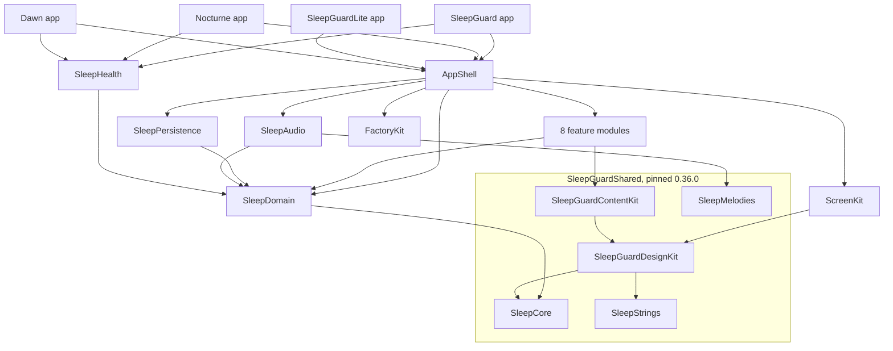

# Architecture

SleepGuardUIKitWay is SleepGuard (a SwiftUI sleep and snoring app) rebuilt the way a large UIKit team would build it. UIKit owns the app and its navigation, SwiftUI draws the screens, the business rules sit in a domain core behind ports, and four brands ship from one codebase. The rules, strings, design kit and screen layouts are shared with SleepGuard through a separate repo, so both apps compute and draw the same things from the same inputs.

Everything below was checked against the code on 2026-11-26 (shared release 0.36.0). Counts and names come from the source, not from the plans.

## Module graph

Tuist sees the apps and what they link directly (`tuist graph --skip-test-targets`):

```
SleepGuard      → AppShell, SleepGuardDesignKit, SleepHealth
Nocturne        → AppShell, SleepGuardDesignKit, SleepHealth
Dawn            → AppShell, SleepGuardDesignKit, SleepHealth
SleepGuardLite  → AppShell, SleepGuardDesignKit            (no HealthKit)
```

Inside the packages, the graph is in their manifests (`swift package dump-package`, non-test targets):



The eight features are History, SessionDetail, Statistics, Recording, Settings, Onboarding, Briefing and Learn. Not every one imports `SleepDomain`: Onboarding, Briefing and Learn need only SleepCore values and the content kit. No feature imports another feature, an adapter, or Factory.

## The layers

| Module | Files / lines | What it holds | What it must not do |
|---|---|---|---|
| `SleepCore` (shared) | — | Night values and every rule: score, detection state machine, statistics, playback, interrupter, onboarding pages, briefing, report | Import anything but Foundation |
| `SleepDomain` (Core) | 26 / 1,400 | 14 ports, 12 use cases, the recording actor and its draft, preferences | Know about SwiftData, AVFoundation, HealthKit, UIKit or SwiftUI |
| `SleepPersistence` | 11 / 703 | SwiftData records behind `SessionRepository`; files for clips, checkpoint, profile, raw log, survey answers; UserDefaults preferences | Leak a `@Model` past its ports |
| `SleepAudio` | 11 / 1,099 | AVAudioEngine capture and analysis, clip compression and playback, waveforms, the interrupter's player, store and recorder | |
| `SleepHealth` | 1 / 45 | Apple Health through the shared `HealthKitSleep` (the same code as SleepGuard): write a night, read its sleep stages | Be linked by Lite |
| `ScreenKit` (Presentation) | 6 / 615 | `ScreenController` (every screen's base: chrome, background, theme, one state child), `ContentListController` (a self-sizing UIKit list), `ScreenChrome`, `Navigator`, theme fonts for UIKit | |
| Features | 60 / 3,737 | 22 UIKit screens (ADR 0007): collection views, a page view controller, a segmented control and alerts around the shared SwiftUI content. Each has a view model (ADR 0008, checked) that holds its state, calls the use cases and routes and says which alert is due, with no UI imports. Each screen has a `Dependencies` and a `Routes` value | Navigate, present anything but an alert, persist, inject, or touch `UIApplication`; import UI in a view model (checked) |
| `AppShell` | 31 / 2,350 | Launch and links, the composition root (`AppComposition`, ADR 0009), 6 flows with their navigation helpers, coordinators, factories, the Factory container (33 registrations) | Be imported by anything but the apps and its test support |
| Apps | 4 brands | `Brand.swift`: one `BrandConfiguration` each; assets; Info.plist from the Tuist brand list | Contain logic |

## How a screen comes up: a night's detail

1. A row in History calls `HistoryRoutes.openNight(summary)`. The screen only reports the intent.
2. `HistoryFlow` hands it to `NightDetailNavigation.show(_:)`, which asks `SessionDetailFactory.make(...)` for a controller and pushes it through its `Navigator`.
3. The factory resolves `LoadSessionDetail` and `EnrichNightWithStages` from the container and builds `SessionDetailViewModel(dependencies:routes:)`, then `SessionDetailViewController(viewModel:theme:chrome:)`. The chrome carries the title and the bar items (report, delete); the screen never sets them. The report button has a `BarItemActivity`, so it shows a spinner while the PDF is made.
4. When the screen appears, the controller runs `viewModel.load()` in a task it owns. `LoadSessionDetail` only reads the night from `SessionRepository`; then `EnrichNightWithStages` asks `SleepStageSource` for stages when the night has none (the brand's Apple Health, or nothing in Lite) and stores them with the new score through `updateStages`, without touching events. A failed save still shows the stages (ADR 0010).
5. The screen lays the night out in a UIKit compositional collection view (`NightDetailController`, items from the tested `NightDetailItems`): the shared header, stages card, timeline, banners and event rows are hosted cells; the filter is a `UISegmentedControl`. Tapping Play, Show all, Share or the stages' info calls a route; the navigation object presents the sheet.

Every screen follows this shape: intent out through `Routes`, data in through `Dependencies`, presentation decided by a flow. A flow is built by `AppComposition` with exactly what it uses (ADR 0009); only the factories read the container.

## Launch and links

`AppShell.bootstrap(brand:)` builds the brand's `AppComposition` (its own container, the brand registered first) and its `AppCoordinator`. The coordinator shows only "We couldn't open your sleep data" when the nights database didn't open (ADR 0010); otherwise the onboarding or the tabs, then a night left unfinished, stale scores recomputed, the storage limits and the briefing. Links (`<scheme>://start`, `session/<id>`, `last7nights`) reach it from the scene delegate as an `AppRoute`, and wait while a night records or a sheet is up (ADR 0012).

## Brands

`BrandConfiguration` (AppShell) is the only place brands differ at runtime. Each brand states every value; the initializer has no defaults (ADR 0006):

| Value | SleepGuard | Nocturne | Lite | Dawn |
|---|---|---|---|---|
| `theme` | SleepGuard's | violet, amber for recording, rounded type, softer corners | teal | warm sunrise |
| `tabs` | Statistics, History, Settings, Learn | History, Statistics, Settings, Learn | Statistics, History, Settings | Statistics, History, Settings |
| `health` (a port, or `nil`) | `SleepHealth` | `SleepHealth` | `nil`: no HealthKit linked, no stages, no Health rows or onboarding page | `SleepHealth` |
| `snoreInterrupter` | on | on | off | off |
| `learnURL` | `nil` for now | `nil` for now | no tab | no tab |
| `appStoreID` | `nil` | `nil` | `nil` | `nil` |

Dawn is the worked example in [ADDING_A_BRAND.md](ADDING_A_BRAND.md).

Identity (bundle id, display name, app group, URL scheme) lives in the Tuist brand list and reaches the app through Info.plist. Brand differences are read only in the container, the coordinators and the factories; there is no brand enum to switch on.

## The shared repo

`../SleepGuardShared` is its own git repo, pinned by exact version in every manifest and in `Project.swift`:

| Product | Holds |
|---|---|
| `SleepCore` | The rules both apps compute with |
| `SleepStrings` | The string catalog and generated `Strings` |
| `SleepMelodies` | The Snore Interrupter's built-in sounds |
| `SleepGuardDesignKit` | Theme tokens and components that draw values |
| `SleepGuardContentKit` | Screen layouts: values and closures in (ADR 0005) |

`tuist generate` builds against the local checkout for day-to-day work; `TUIST_SHARED_RELEASE=1` builds the pinned release. A shared change is a release: tag it, run `scripts/bump-shared.sh`, run the tests in both apps.

## Recording a night

`RecordingSession` (an actor in `SleepDomain`) turns microphone samples into a `RecordingDraft`:

1. `AudioCapture` (`SleepAudio`'s AVAudioEngine tap) yields a `CaptureEvent`: a sample per buffer (about 43–47 Hz), or the microphone taken away (a call) and given back.
2. SleepCore's `SampleDecimator` turns the buffers into 20 Hz samples on a time grid, as SleepGuard does. Each is classified with SleepCore's snore and speech rules and sent, timestamped, into SleepCore's `DetectionEngine`: one ordered stream, on its own actor. A call goes in as `captureDidPause` / `captureDidResume` and becomes an interruption gap the score leaves out (ADR 0011).
3. The engine's outputs come back in order: clips start, close or are discarded through the capture port; events and gaps go into the draft; the Snore Interrupter plays with the microphone paused.
4. The draft is checkpointed by a writer task off the sample path (the newest night wins), so a killed app offers the night at the next launch; Save commits it through `CommitSession` (and to Apple Health when on), refusing a night shorter than the app's `SaveRules`.

The same rules, the same 20 Hz samples and the same test cases run in SleepGuard, so both apps detect the same events from the same sound.

## Rules and how they're enforced

| Rule | Enforced by |
|---|---|
| Each module imports only what its row allows; a new module must be added to the table | `scripts/check-layering.py` |
| Features don't navigate, present, persist, inject or use `UIApplication` / `UIDevice` | `check-layering.py`; a screen presenting anything but an alert doesn't compile (`ScreenController.present` is unavailable) |
| SwiftUI is hosted only through ScreenKit, which puts the brand's theme in the environment | `check-layering.py` |
| Every port with state: the adapter and its fake pass the same contract | `PortContracts` in `SleepDomainTestSupport` |
| No `.shared` singletons in packages, `Container.shared` included (`DeviceServices` excepted) | `check-layering.py` |
| No `print`; `os.Logger` | `check-layering.py` |
| Swift 6 language mode everywhere; no `@unchecked Sendable`, `nonisolated(unsafe)` or `@preconcurrency`, except one listed lock on the audio thread | `check-layering.py` and the compiler |
| UI packages (Presentation, Features, AppShell) default to `MainActor` isolation | Their manifests |
| A view file at most 200 lines; a screen (`*Screen.swift`) at most 100 | `scripts/check-view-size.py` |
| No user-facing literal outside `Strings` | `scripts/check-hardcoded-strings.py` |
| A package builds on its own, so an undeclared import fails | `scripts/run-tests.sh` (packages lane: own derived data per package) |

## Tests

`sh scripts/run-tests.sh` runs three lanes:

| Lane | What | |
|---|---|---|
| macOS | `swift test` in Core: use cases and the recording actor against fakes | seconds |
| Packages | Each package built standalone on the simulator, its tests run | Adapters against real files and stores; Features' state owners; AppShell's flows over a navigator spy |
| In-app | Each brand's hosted tests inside that brand's app | Bootstrap, tabs, a night's detail, the player, the recording flow |

About 290 package tests and 13 in-app tests per brand (pull requests run every brand's bootstrap and one brand's whole suite; nightly runs all), plus the shared repo's own (rules, renders of every screen's content in two themes, detection replay goldens).

## Decisions

| ADR | Decision |
|---|---|
| [0001](adr/0001-uikit-shell-swiftui-screens.md) | UIKit shell, SwiftUI screens |
| [0002](adr/0002-hexagonal-core.md) | A hexagonal core: ports and use cases, adapters outside |
| [0003](adr/0003-white-label-brands.md) | White-label brands from one codebase |
| [0004](adr/0004-shared-repo.md) | Shared code in its own repo, pinned by version |
| [0005](adr/0005-shared-screen-content.md) | Screen layouts shared too; each app hosts them |
| [0006](adr/0006-brand-capabilities.md) | A brand capability is a port it builds or a value it states |
| [0007](adr/0007-uikit-screen-containers.md) | Every screen a UIKit controller; shared SwiftUI draws the cells and pages |
| [0008](adr/0008-view-models.md) | A view model for every screen (checked); flows' factories build them |
| [0009](adr/0009-typed-composition.md) | One composition per brand; flows take what they use |
| [0010](adr/0010-stored-nights.md) | Stored nights: versioned scores, one writer, safe failures |
| [0011](adr/0011-detection-input.md) | Detection runs on 20 Hz samples, off the disk |
| [0012](adr/0012-deep-links.md) | Links open through the app coordinator |

## Where to look first

- `Packages/AppShell/Sources/AppShell/Composition/AppComposition.swift`: the object graph, and what each flow gets.
- `Packages/AppShell/Sources/AppShell/Coordinators/AppCoordinator.swift`: launch, onboarding or tabs, the recording flow, the briefing, links.
- `Packages/AppShell/Sources/AppShell/History/`: a flow, its factories and a navigation object end to end.
- `Packages/Core/Sources/SleepDomain/Recording/RecordingSession.swift`: the recording actor.
- `Apps/Nocturne/Sources/Brand.swift`: everything a brand is; [ADDING_A_BRAND.md](ADDING_A_BRAND.md) adds one.
- `scripts/check-layering.py`: the boundaries, as code.
- [COMPARISON.md](COMPARISON.md): the same feature in SleepGuard's SwiftUI shape, and what each shape costs.
